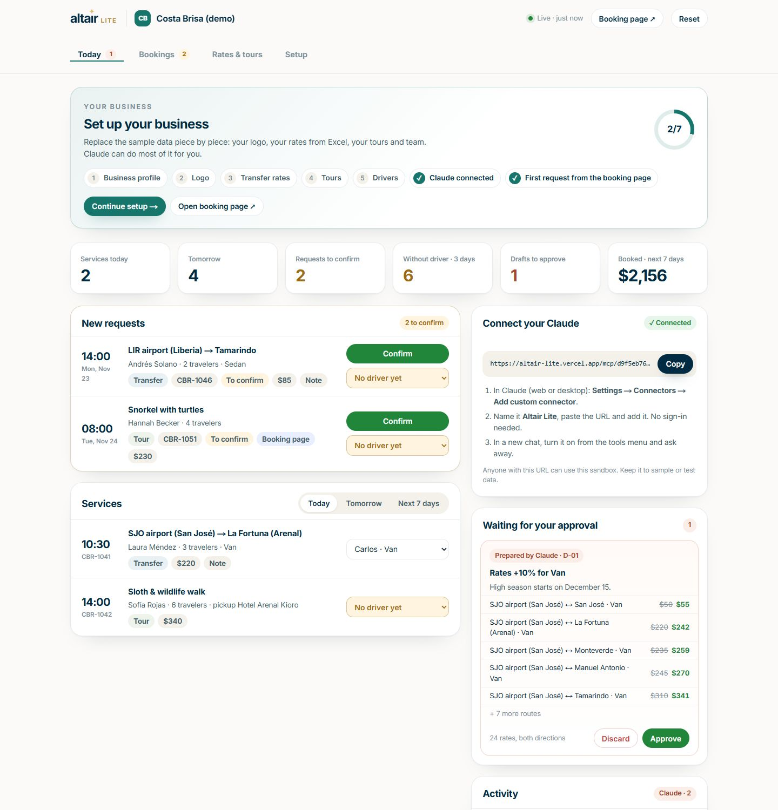
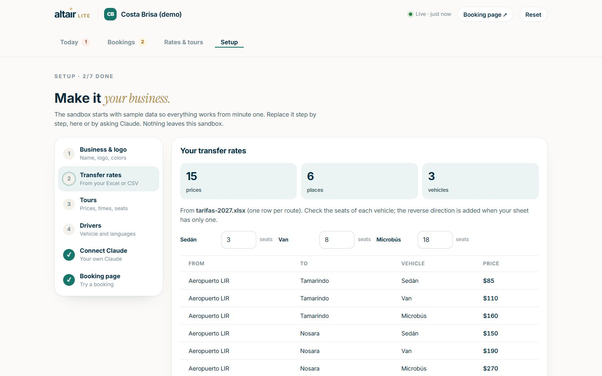
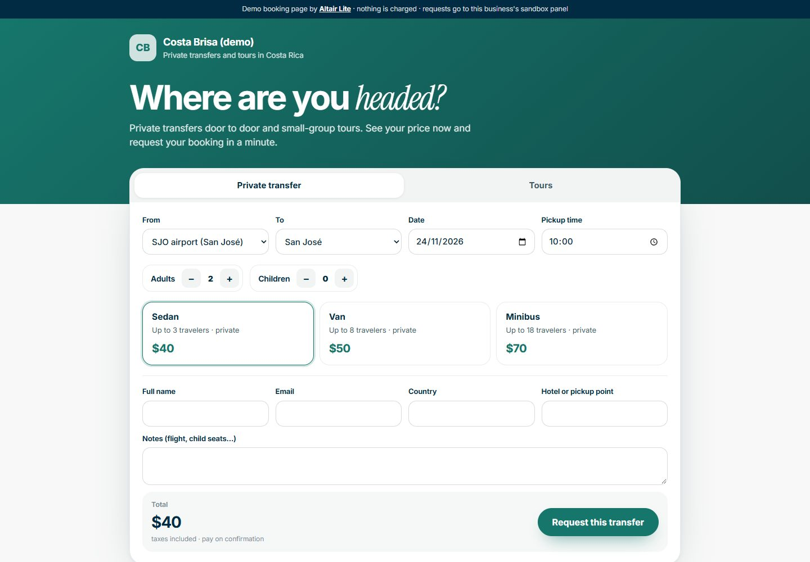

# Altair Lite

**Run a small tourism business from your own Claude.** An open, experimental demo of the idea behind
[Altair by Starknot](https://altair-hub.vercel.app): open a private sandbox of a transfer and tour company, connect it
to Claude in one step, ask in plain words, and watch the panel change while Claude works.

<p>
  <a href="https://altair-lite.vercel.app"><b>Try it live → altair-lite.vercel.app</b></a> ·
  no sign-up, no keys, sample data only
</p>



<table>
  <tr>
    <td width="50%"><br><sub><b>Guided setup.</b> Your logo, colors and the Excel you already use for your rates.</sub></td>
    <td width="50%"><br><sub><b>Your booking page.</b> Travelers request transfers and tours; requests land in the panel live.</sub></td>
  </tr>
</table>

## How it works

1. **Set up your business, or explore the sample.** [Set up my business](https://altair-lite.vercel.app/new?setup=1)
   opens a guided setup; [the sample](https://altair-lite.vercel.app/new) opens *Costa Brisa (demo)* as it is. Either way
   the sandbox starts with sample bookings, drivers, rates and tours, so everything works from minute one.
2. **Make it yours.** Name, logo (the brand color is suggested from it), WhatsApp and booking code prefix. Drop the
   **Excel (.xlsx) or CSV** you already use for your rates: places, vehicles and prices are read in the browser, with
   Spanish or English headers, one row per route or one row per price. Then your tours and drivers.
3. **Connect your own Claude.** Copy your connector URL from the panel (`https://altair-lite.vercel.app/mcp/<your-sandbox>`)
   into **Claude → Settings → Connectors → Add custom connector**. No sign-in, no keys. Claude can finish the setup for
   you: share your rate sheet in the chat and it loads it as a draft you approve.
4. **Take a booking.** Your sandbox has a **booking page** with your logo, colors, routes, prices and tours with real
   seats. A traveler requests a transfer or a tour and it lands in the panel within seconds, ready to confirm.
5. **Ask.** "What's on tomorrow, and who still needs a driver?" · "Assign drivers without clashing times." ·
   "Add this WhatsApp booking as a request." · "Raise Van rates 10% as a draft." **Prices, rate sheets and new tours
   are drafts**: nothing changes until a person approves them.

## The connector (MCP)

A remote [Model Context Protocol](https://modelcontextprotocol.io) server written without dependencies
(`lib/mcp.ts`): Streamable HTTP, JSON responses, stateless. Read tools never change anything; the others are logged
in the panel's activity feed.

| Tool | What it does |
|---|---|
| `business_overview` | Today and tomorrow, services without a driver, requests (including the booking page), drafts, setup progress |
| `day_schedule` | Every service of one day, in time order |
| `find_bookings` | Search by customer, code, place or tour |
| `booking_details` | One booking by its code |
| `quote_transfer` | Price per vehicle that fits the group |
| `quote_tour` | Tour price for a group and seats left per departure |
| `create_booking` | Turns a WhatsApp or email message into a booking request (price from the business's own rates) |
| `list_drivers` | Drivers, vehicles, languages and their day |
| `assign_driver` | Assigns a driver; refuses time clashes and vehicles that are too small |
| `propose_rate_change` | Prepares a rate change as a **draft** for a person to approve |
| `list_drafts` | Drafts and their status |
| `draft_customer_message` | A confirmation, reminder or driver message (EN/ES), never sent |
| `setup_checklist` | What is set up and what is missing, with how to do each step |
| `update_business_profile` | Name, tagline, WhatsApp, email, booking prefix, brand color |
| `import_rates` | Loads the owner's rate sheet as **one draft** that replaces places, vehicles and rates when approved |
| `add_tour` | A new or updated tour as a **draft** |
| `add_driver` | Adds a driver with vehicle and languages |

There is also a shared sandbox at `https://altair-lite.vercel.app/mcp` for a quick try.

## Run it yourself

```bash
git clone https://github.com/altairbystarknot/altair-lite.git
cd altair-lite
npm install
npm run dev            # http://localhost:3200
npm run smoke          # talks to the local connector like Claude does
```

Without configuration, sandboxes live in memory and reset when the server restarts. To keep them, create a Supabase
project, run [`supabase/schema.sql`](supabase/schema.sql) in its SQL editor and set `SUPABASE_URL` and
`SUPABASE_PUBLISHABLE_KEY` (see `.env.example`). The table is closed to the API; the app only calls two database
functions that accept a valid sandbox id and a bounded document, with optimistic concurrency.

To try a local server from Claude, expose it over HTTPS (for example with a tunnel) and add `<url>/mcp/<sandbox>`
as a custom connector.

## What Altair Lite is, and is not

- An **experimental demo**, built with Claude Code for the Dojo AI Hackathon 2026, to show the idea: the owner runs
  the business from their own Claude, and a person approves what matters.
- **Simplified on purpose**: one price per route and vehicle, no payments, no real messages, no accounts. It is not
  Altair's engine. Use sample or test data: the sandbox URL is its only key.
- Each sandbox is private by its long random id. Anyone with the URL can use that sandbox, which only holds sample
  data. Sandboxes nobody touches for two weeks are forgotten.

**Need the real thing?** [Altair](https://altair-hub.vercel.app) is Starknot's full booking system for tourism
businesses. For a serious operation, Starknot builds custom software, quoted separately:
[book a free discovery session](https://www.starknot.co/en/contacto).

## Stack

Next.js 16 · React 19 · TypeScript · Supabase (Postgres) · Vercel · Model Context Protocol

## License

[MIT](LICENSE) © 2026 Starknot
